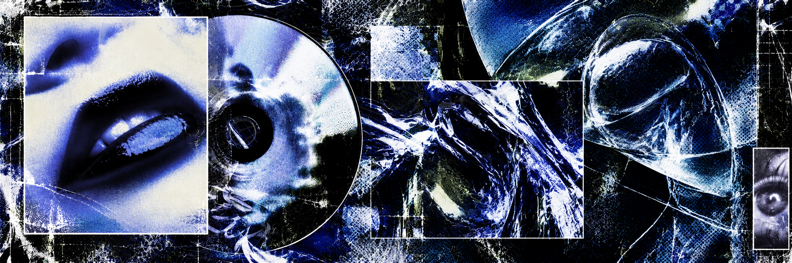

index / 01–04

- [Nexus Studio](https://github.com/frank367763/nexus-studio) · запись, сэмплы и дорожки на C# / WPF
- [ArrayLab](https://github.com/frank367763/array-lab) · массивы, Excel и тесты
- [SmartAutoService](https://github.com/frank367763/smart-auto-service-design) · как устроен заказ в автосервисе, в UML
- [Life](https://github.com/frank367763/Life_game2) · клеточный автомат на C++ / SDL2

в работе

- Quest · приложение для Android на Java
- SystemAnal · классификация состояния воздуха на Python и scikit-learn
