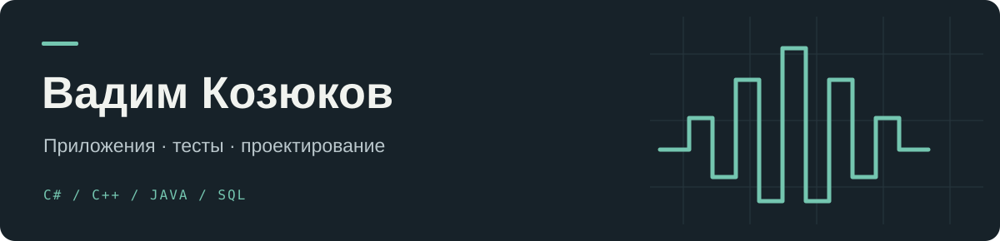

Я Вадим. Учусь на выпускном курсе ПГУ, на направлении «Математическое обеспечение и администрирование информационных систем». Сейчас ищу первую работу по специальности.

За время учёбы работал с C#, Java, C++, JavaScript и SQL: делал приложения, разбирался с алгоритмами, проектированием систем и тестированием. Здесь собрал несколько работ, которые лучше показывают, чем я занимался.

### Что посмотреть

| Проект | Что внутри |
| :--- | :--- |
| [Nexus Studio](https://github.com/frank367763/nexus-studio) | Аудиоприложение на C# и WPF: запись, сэмплы, три дорожки и экспорт микса. |
| [ArrayLab](https://github.com/frank367763/array-lab) | Windows Forms, импорт TXT/XLSX, обработка массива и тесты MSTest. |
| [Game of Life](https://github.com/frank367763/Life_game2) | Клеточный автомат на C++ с графикой SDL2. Одна из более ранних работ. |

Мне интересно понимать, как устроена задача: от требований и модели данных до работающего приложения и проверки результата. Использую AI-инструменты, в том числе Codex, для работы с кодом и обучения.

Рассматриваю стажировку или junior-позицию в разработке, тестировании либо системном анализе. Готов выполнить тестовое и обсудить свои проекты.
